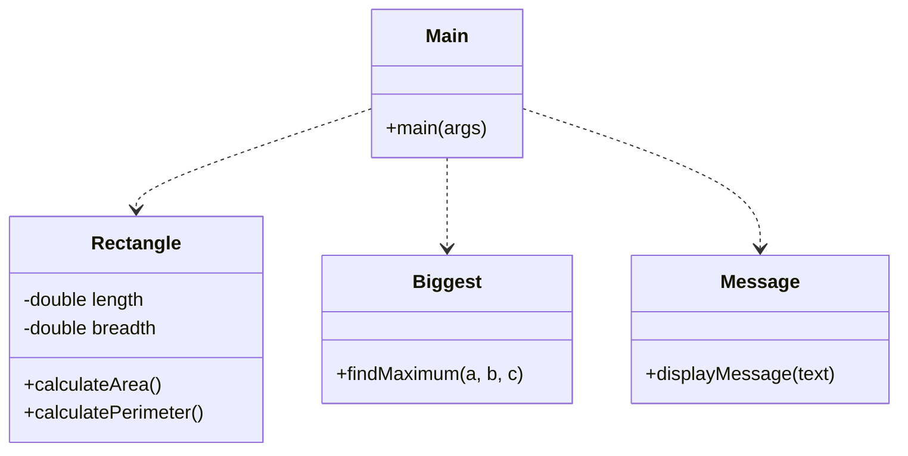

<p align="center">
  
</p>

<p align="center">
   
</p>


## 📌 Table of Contents
- [📖 Executive Summary](#-executive-summary)
- [✨ Key Features & Capabilities](#-key-features--capabilities)
- [🏗️ System Architecture & Workflow](#️-system-architecture--workflow)
- [🛠️ Tech Stack Breakdown](#️-tech-stack-breakdown)
- [⚙️ Reproducible Quickstart & Setup](#️-reproducible-quickstart--setup)
- [📂 Project Directory Layout](#-project-directory-layout)
- [👩‍💻 Author & Contributions](#-author--contributions)

---

## 📖 Executive Summary
### Problem Statement
Validating object-oriented design requires testing class encapsulation, geometric mathematical calculations, and comparative algorithms in isolated test cases.

### Motivation & Solution Overview
A structured Java OOP exploration implementing geometric calculation classes (`Rectangle.java`), maximum element algorithms (`Biggest.java`), and modular messaging services (`Message.java`).

---

## ✨ Key Features & Capabilities
- **Encapsulated Geometry:** Area and perimeter calculation methods on Rectangle entities.
- **Comparative Logic:** Object comparison utilities finding maximum values.
- **Modular Driver:** Unit execution through `Main.java`.

---

## 🏗️ System Architecture & Workflow


---

## 🛠️ Tech Stack Breakdown
| Category | Technologies |
|---|---|
| **Language** | Java |
| **Concepts** | Encapsulation, Methods, Object Instantiation |

---

## ⚙️ Reproducible Quickstart & Setup
```bash
git clone https://github.com/Bhumikaravi/Bhumika_Test2.git
cd Bhumika_Test2
javac *.java
java Main
```

---

## 📂 Project Directory Layout
```text
Bhumika_Test2/
├── Biggest.java
├── Main.java
├── Message.java
├── Rectangle.java
└── README.md
```

---

## 👩‍💻 Author & Contributions
Developed by **Bhumika Ravi** ([@Bhumikaravi](https://github.com/Bhumikaravi)), Bachelor of Computer Applications (BCA) at **Alliance University, Bengaluru**.

- 💻 **GitHub Profile:** [github.com/Bhumikaravi](https://github.com/Bhumikaravi)
- 🔗 **LinkedIn:** [linkedin.com/in/bhumika-ravi-b5a01b326](https://www.linkedin.com/in/bhumika-ravi-b5a01b326/)
- 📬 **Email Contact:** [bhumikaravi2006@gmail.com](mailto:bhumikaravi2006@gmail.com)

---

<p align="center">
  
</p>
